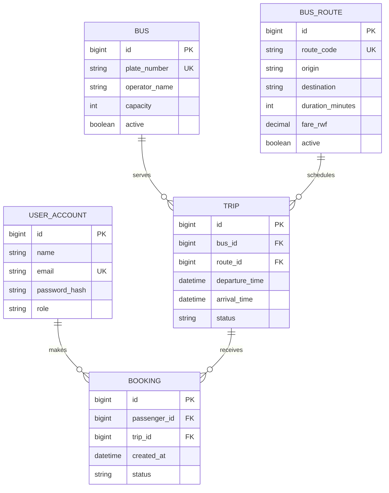
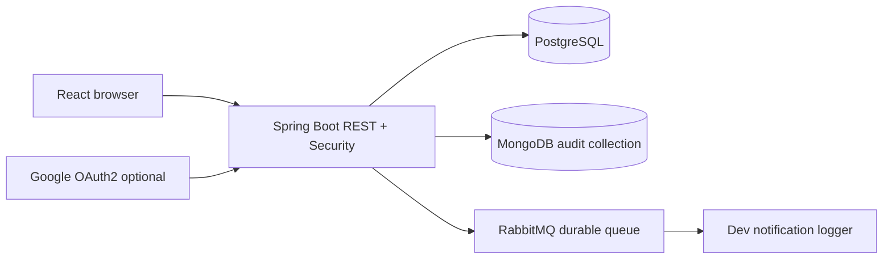

# Kigali Bus Management System (KBMS)

**Course:** Web Technology · Academic year 2026–2027  
**Project:** Kigali Bus Management System  
**Purpose:** make Kigali routes, timetables, bus management, and passenger bookings available online.

## 1. Problem, objectives, users, scope

**Problem:** passengers have difficulty finding consolidated bus routes and departure schedules, while operators need a central workflow to manage vehicle and route data.  
**Users:** passengers, transport operators, and system administrators.  
**Objectives:** provide a searchable schedule; let passengers book a seat; allow authorized staff to maintain routes/fleet/trips; maintain security and auditability.  
**Scope:** demo-managed routes, buses, trips, bookings and account access. Not included: actual GPS/tracking, public transit API sync, payments or live SMS delivery.

**Functional requirements:** account registration and login; route search; trip schedules; ticket reservations; fleet/route maintenance; schedule status changes; role management; audit history; message broker integration.  
**Quality attributes / targets (to validate):** responsive layout from 360px to desktop; typical demo GET API latency under 1 second locally; passwords BCrypt-hashed; restricted write APIs; CSRF protection; unique trip bookings, unique user emails/plates/route codes; logs of privileged changes in MongoDB.

## 2. Use cases & acceptance criteria

1. **As a passenger**, I can search routes and find matching departures. **Accepted when:** the search filters route code, origin and destination and the schedule lists departure, arrival and status.
2. **As a passenger**, I can register and book a future scheduled trip. **Accepted when:** my seat booking appears in My Bookings, duplicates are refused and a full bus cannot accept an additional booking.
3. **As an operator**, I can add vehicles/routes and schedule trips. **Accepted when:** validated records appear in the UI; only admins/operators may change schedules, and schedule changes are logged.

## 3. Conceptual model

**Actors:** PASSENGER, OPERATOR, ADMIN.  
**Processes:** account onboarding, transport scheduling, booking, audit, notification.  
**Data:** UserAccount, Bus, BusRoute, Trip, Booking, AuditEvent, RabbitMQ notification message.

## 4. ER / implementation-oriented schema

**Constraints:** booking `(passenger_id,trip_id)` unique; foreign keys for trip/bus, trip/route, booking/user, booking/trip; unique email, route code and bus plate; departure-time index. Separate MongoDB `audit_events` documents hold `id, action, actor, details, createdAt` without relational foreign keys.

## 5. Architecture

Layered monolithic backend using Spring Controllers, repositories (JPA/Mongo), security config and service. React front end makes credentialed API requests. Docker Compose deploys five services (frontend, backend, PostgreSQL, MongoDB, RabbitMQ).

## 6. Authorization and security

Passwords BCrypt hashed; session-based authentication; cookie CSRF mechanism; Google OAuth2 authorization code flow optionally enabled by credentials. PASSENGER views own bookings. OPERATOR and ADMIN edit transport resources. ADMIN manages account roles and views audit. **Production improvement:** enforce per-operator ownership, rate-limit login, avoid auto-DDL, secure cookie over HTTPS and use a secrets manager.

## 7. Testing & demo checklist

- [ ] Docker services start and `/api/health` reports UP.
- [ ] Responsive layout works at mobile and desktop widths.
- [ ] New passenger can register and log in.
- [ ] Passenger denied access to POST `/api/routes` (403).
- [ ] Admin adds a route, bus and trip; new trip appears in schedule.
- [ ] Passenger books once, duplicate booking returns 409.
- [ ] Admin changes user role to OPERATOR; user signs back in and obtains staff access.
- [ ] Admin views audit event for route creation.
- [ ] RabbitMQ management shows `kbms.notifications`; backend logs demonstrate consumed events.
- [ ] Google OAuth2 login works **after** credentials and callback are configured.
- [ ] Git history shows staged milestone commits and a PR to main.

## 8. Submission evidence

Capture screenshots of: public homepage, responsive phone size, schedule list, login/register, operator dashboard, booking list, admin RBAC, MongoDB audit, RabbitMQ queue, successful Docker containers, Git history and PR.

## 9. Evaluation mapping

1. Requirements/user stories: sections 1–2. 2. Conceptual+ER+schema: sections 3–4. 3. Responsive React: frontend. 4. Spring Boot layered backend: backend. 5. Relational and non-relational: PostgreSQL and MongoDB. 6. OAuth2: configurable Google login and local auth. 7. RabbitMQ: queue and notification simulation. 8. RBAC: Spring Security. 9. Git/PR: complete separately in VS Code. Bonus: Docker Compose; manual quality checklist (automated testing is further work).
